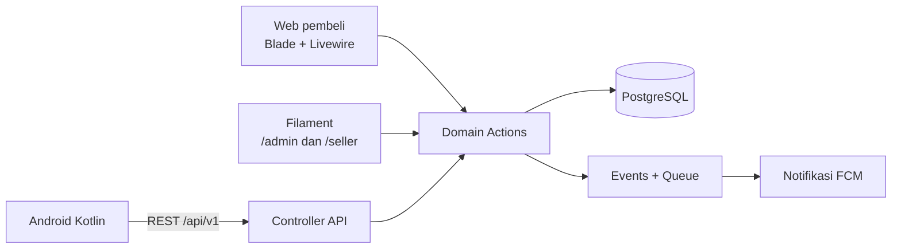

# Seafood Marketplace

Marketplace hasil laut multi-penjual: pemilik usaha hasil laut (kepiting, cumi, tiram, ikan) mengelola toko lewat aplikasi Android, pembeli belanja lewat web, dan admin mengelola platform lewat dashboard.

Proyek ini adalah rebuild skripsi LP3I (2020): aplikasi penjualan kepiting untuk satu UD yang dulu dibangun dengan Android Java. Versi ini dibangun ulang dari nol dengan Laravel dan Kotlin, lalu dikembangkan menjadi marketplace multi-penjual.

> Status: **Tahap 1 (Fondasi)** sedang dikerjakan. Lihat [milestones](https://github.com/SaptooAji/seafood-marketplace/milestones) dan papan kerja di [GitHub Project](https://github.com/users/SaptooAji/projects/2).

## Fitur MVP

- **Pembeli (web):** jelajah katalog tanpa login, filter kondisi (hidup, segar, beku, marinasi) dan toko terdekat, keranjang tamu, login Google saat checkout, checkout terpisah per toko, pre-order dengan tanggal kirim, upload bukti transfer.
- **Penjual (Android):** profil toko dengan pin lokasi, metode pengiriman sendiri (diantar, ambil di tempat, ojek online, ekspedisi), produk dengan varian, konfirmasi stok harian, buku stok, jadwal produksi pre-order, notifikasi pesanan.
- **Admin (web):** verifikasi toko, kategori dengan standar kualitas, moderasi produk, pengaturan platform, activity log.

Detail lengkap ada di [docs/prd.md](docs/prd.md).

## Tech stack

| Bagian | Teknologi |
| --- | --- |
| Backend dan REST API | Laravel 13, PHP 8.4, PostgreSQL 16, Sanctum, Socialite, spatie/laravel-permission, spatie/laravel-activitylog, intervention/image |
| Web pembeli | Blade + Livewire |
| Admin dan panel penjual | Filament (`/admin`, `/seller`) |
| Aplikasi penjual | Kotlin, Jetpack Compose, Hilt, Retrofit, Room |
| Notifikasi | Firebase Cloud Messaging lewat queue |
| Kualitas | Pest, Larastan level 6, Pint, ktlint, detekt, GitHub Actions |

## Arsitektur

Satu aplikasi Laravel melayani tiga pintu masuk (web, Filament, REST API). Ketiganya memanggil Action yang sama di lapisan domain, sehingga aturan bisnis seperti potong stok dan transisi status pesanan hanya ditulis sekali.



Kode backend memakai struktur bawaan Laravel; logika bisnis ada di Action:

```
backend/app/
  Actions/  Data/  Enums/  Events/  Exceptions/  Listeners/  Models/  Policies/
  Http/  Filament/  Livewire/
```

## Struktur repository

```
backend/    Aplikasi Laravel
android/    Aplikasi Android (menyusul di tahap 4)
docs/       PRD, standar engineering, dan catatan rilis (docs/releases/)
.github/    CI dan template issue
.githooks/  Hook git: format saat commit, cek kualitas saat push, status project saat branch dibuat
```

## Menjalankan di lokal

Kebutuhan: PHP 8.4 (dengan ekstensi `gd`) dan Composer (misalnya lewat [Laravel Herd](https://herd.laravel.com)), PostgreSQL 16, Node.js.

```bash
git clone https://github.com/SaptooAji/seafood-marketplace.git
cd seafood-marketplace/backend

# Database untuk aplikasi dan untuk test
psql -U postgres -c "CREATE DATABASE seafood_marketplace;"
psql -U postgres -c "CREATE DATABASE seafood_marketplace_test;"

composer install            # juga mengaktifkan hook git di .githooks
cp .env.example .env        # isi DB_PASSWORD
php artisan key:generate
php artisan migrate
php artisan storage:link    # foto produk disajikan dari storage/app/public
composer run dev
```

## Kualitas kode

Jalankan dari `backend/`:

| Perintah | Fungsi |
| --- | --- |
| `composer check` | Pint (cek format), Larastan, dan Pest. Sama dengan CI |
| `composer fix` | Format dengan Pint, lalu Larastan dan Pest |
| `php artisan test` | Hanya test |

Hook pre-commit memformat file PHP yang di-commit, hook pre-push menjalankan `composer check`, dan hook post-checkout memindahkan issue ke In Progress di GitHub Project saat branch issue dibuat. CI menjalankan pemeriksaan yang sama dengan PostgreSQL.

## Alur kerja

- Pekerjaan direncanakan sebagai GitHub issue per milestone. Setiap issue berisi kriteria selesai dan daftar test case.
- Test ditulis lebih dulu, lalu implementasi sampai hijau.
- Satu issue = satu branch (`feat/2-order-status`) = satu PR dengan `Closes #2`, di-merge dengan squash.
- Commit mengikuti [Conventional Commits](https://www.conventionalcommits.org).

Aturan lengkap ada di [docs/engineering-standards.md](docs/engineering-standards.md).

### Penggunaan AI

Proyek ini dikerjakan bersama Claude Code. Kode domain (Actions, aturan bisnis, model) ditulis oleh pemilik repo; Claude Code membantu menulis test, boilerplate, konfigurasi, dokumentasi, dan review. Commit yang dibuat dengan bantuan AI ditandai `Co-Authored-By`. Aturan untuk agen ada di [CLAUDE.md](CLAUDE.md).
