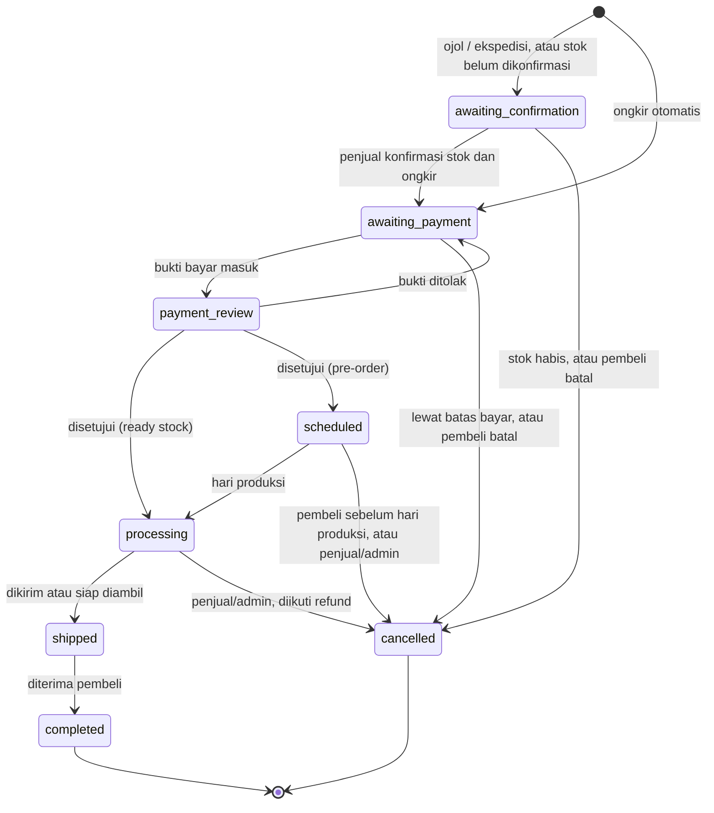
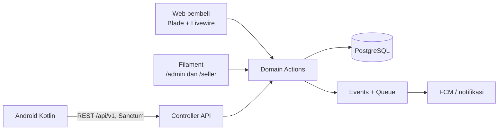

# PRD: Marketplace Hasil Laut (MVP)

> Product Requirements Document. Sumber kebenaran untuk scope MVP, model data, alur status, dan API. Standar kode ada di [engineering-standards.md](engineering-standards.md).

## Ringkasan

MVP ini adalah marketplace hasil laut multi-penjual: pemilik usaha mengelola toko lewat aplikasi Android, pembeli belanja lewat web, dan admin mengelola platform lewat dashboard. Proyek ini adalah rebuild skripsi LP3I (aplikasi penjualan kepiting untuk satu UD, Android Java, 2020) dan sekaligus portofolio Android modern dan Laravel.

| Bagian | Teknologi | Pengguna |
| --- | --- | --- |
| Backend + REST API | Laravel 13 (PHP 8.4), PostgreSQL 16, Sanctum, Socialite, FCM | Semua klien |
| Web pembeli | Blade + Livewire (di dalam Laravel) | Pembeli |
| Admin dashboard | Filament (di dalam Laravel) | Super Admin, Admin; panel /seller untuk pemilik toko |
| Aplikasi pemilik usaha | Android Kotlin + Jetpack Compose | Penjual |
| Aplikasi kurir (nanti) | React Native | Kurir |

Cerita portofolio: tersertifikasi Android Java (2020); skripsi dibangun ulang dengan Kotlin + Compose dan backend Laravel, lalu dikembangkan dari toko satu UD menjadi marketplace multi-penjual.

## Peran dan ruang lingkup MVP

Ada tiga peran di MVP. Aplikasi kurir belum dibuat; setiap toko memilih metode pengiriman sendiri, termasuk diantar oleh pemilik atau karyawannya, karena ojek online jarang tersedia di banyak daerah.

**Pembeli (web)**

- Jelajah katalog tanpa login: per kategori, cari, filter kondisi (hidup, segar, beku, marinasi), toko, dan **toko terdekat** (jarak dari lokasi browser atau alamat)
- Lihat detail produk: foto, atribut dan standar kualitas kategori, varian ukuran, harga per satuan, stok beserta waktu terakhir diperbarui, jarak toko; stok yang belum dikonfirmasi lebih dari 24 jam diberi penanda
- Keranjang tamu disimpan di session dan digabung ke akun setelah login
- **Login dengan Google** hanya saat checkout; nomor HP dan alamat diminta sekali saat checkout pertama (Facebook menyusul)
- Checkout dipisah otomatis per toko; pilih metode pengiriman yang tersedia untuk jaraknya; untuk produk pre-order pilih tanggal kirim atau ambil yang kuotanya masih tersedia
- Upload bukti transfer, pantau status pesanan dan link tracking bila ada
- Hubungi penjual lewat tombol WhatsApp atau telepon

**Penjual (Android)**

- Register sebagai penjual, isi profil toko, **pin lokasi toko di peta**, dan rekening bank, menunggu verifikasi admin
- Atur **metode pengiriman** toko: diantar sendiri (radius, tarif flat atau per km dengan minimum), ambil di tempat, ojek online, ekspedisi
- CRUD produk: foto (beberapa), nama, deskripsi, kategori beserta atribut wajibnya, kondisi, mode penjualan (ready stock, atau pre-order dengan kuota harian, lead time, dan jam tutup pesanan), varian (grade/ukuran, satuan, harga, stok)
- **Deskripsi dengan AI:** tombol "Buat deskripsi dengan AI" menyusun deskripsi dan ringkasan SEO dari nama, kategori, atribut, kondisi, mode jual, dan cara penyimpanan; hanya fakta yang diisi penjual, tanpa harga dan klaim kesehatan. Hasilnya saran yang ditinjau dan bisa diedit penjual sebelum disimpan
- **Stok harian:** pengingat di jam pilihan penjual membuka layar Stok hari ini; tombol "Sama seperti kemarin" atau +/- cepat per varian
- **Buku stok:** catat stok masuk (berat, grade, nama penyetor dan harga beli opsional), penjualan offline, dan susut; stok berkurang otomatis saat pesanan dibayar dan kembali saat batal; untuk produk pre-order, layar Jadwal produksi merekap total per varian per tanggal
- Terima notifikasi pesanan baru dan perubahan status (FCM)
- Isi ongkir untuk pesanan ojek online atau ekspedisi, konfirmasi pembayaran, proses dan kirim pesanan
- Hubungi pembeli lewat WhatsApp atau telepon
- Pengaturan: profil, toko, jam pengingat stok, notifikasi, logout

**Admin ****dan pemilik toko di web (Filament, dua panel****)**

- Panel **/admin** untuk platform: verifikasi atau tolak toko, kelola kategori beserta atribut wajib dan teks standar kualitas, moderasi produk, pantau pengguna dan pesanan, ringkasan jumlah toko, pesanan, dan nilai transaksi
- Menu khusus Super Admin: pengaturan platform (batas jam stok basi, batas waktu bayar, daftar satuan, kontak), kelola admin dan roles, activity log (siapa mengubah apa), dan monitor toko yang belum konfirmasi stok
- Panel **/seller** untuk pemilik toko yang lebih suka web, dengan multi-tenancy Filament per toko (lewat store_members); di MVP dibatasi ke produk, stok, dan pesanan

| Role | Panel | Akses |
| --- | --- | --- |
| Super Admin | /admin | Semua, termasuk kelola admin, roles, dan pengaturan |
| Admin | /admin | Verifikasi toko, moderasi produk, kategori, lihat pesanan; tanpa pengaturan dan roles |
| Owner | /seller dan Android | Semua data tokonya, termasuk rekening, member, dan laporan |
| Staff | /seller dan Android | Produk, stok, dan pesanan; tanpa rekening, member, dan laporan |

Role platform memakai spatie/laravel-permission dengan Filament Shield; role owner dan staff disimpan per toko di store_members.

**Di luar MVP**

- Cabang dan mitra: satu pemilik mengelola beberapa toko (parent_store_id), masing-masing dengan lokasi, stok, dan pengiriman sendiri; karyawan atau mitra diundang sebagai member dengan peran terbatas
- Panel /seller lengkap (pengaturan toko, metode pengiriman, member) dan role tambahan: CS/support dan kurir
- Laporan transaksi per toko, kategori, dan periode dengan export Excel; broadcast notifikasi ke penjual; konten beranda (banner, produk unggulan)
- Aplikasi kurir (React Native) untuk karyawan toko, dengan tracking posisi real-time
- Login Facebook, dan email/password untuk pembeli web
- Laporan pembelian per penyetor (nelayan) untuk pengepul
- Payment gateway dengan split ke penjual
- Fitur ekspor: minimum order, harga grosir, dokumen sertifikasi
- Ulasan dan rating, promo dan voucher, komplain kualitas dengan foto setelah barang diterima, badge produk terverifikasi

Prioritas pertama versi 2: chat realtime pembeli dan penjual (Laravel Reverb) di web dan Android.

## Model data (ERD)

Inti modelnya: satu **store** milik satu penjual, produk punya banyak **varian** (ukuran, satuan, harga, stok), dan setiap **order** hanya untuk satu toko. Jumlah pesanan memakai desimal agar bisa 1,5 kg.

| Tabel | Kolom kunci | Relasi |
| --- | --- | --- |
| users | name, email, phone, password (nullable), avatar, role platform via spatie/laravel-permission (super_admin, admin; pembeli tanpa role) | anggota stores lewat store_members, banyak addresses, orders, social_accounts |
| social_accounts | user_id, provider (google, facebook), provider_id | milik users; satu user bisa beberapa provider |
| addresses | label, recipient, phone, address, city, postal_code, lat, lng, is_default | milik users |
| stores | parent_store_id (selalu null di MVP), name, slug, description, phone, address, city, lat, lng, logo, bank_name, bank_account_no, bank_account_name, stock_reminder_time, status (pending, active, rejected, suspended), verified_at, rejection_reason (diisi saat ditolak; `Tidak diketahui` bila admin tidak mengisi alasan) | punya banyak store_members, products, orders, shipping_methods |
| store_shipping_methods | store_id, type (own_delivery, pickup, ojol, expedition), max_radius_km, fee_type (flat, per_km, manual), flat_fee, fee_per_km, min_fee, is_active | milik stores |
| categories | parent_id, name, slug, sort_order, quality_standard | bertingkat (Kepiting > Bakau, Soka) |
| products | store_id, category_id (hanya kategori daun), name, slug, description, seo_description (nullable, maks 160 karakter; bila kosong, meta deskripsi memakai potongan description), condition (live, fresh, frozen, marinated), sales_mode (ready_stock, pre_order), daily_quota, lead_time_days, cutoff_time, shelf_life_days, storage_instructions, is_active (diatur penjual), blocked_at dan block_reason (moderasi admin), deleted_at (soft delete) | punya banyak variants, images |
| product_images | product_id, path, sort_order | milik products |
| product_variants | product_id, name (mis. Grade A 300-400 g), unit (kg, ekor, lusin, pack), price, stock (decimal, hasil dari stock_movements), stock_confirmed_at, min_qty, is_active, deleted_at (soft delete) | milik products |
| cart_items | user_id atau session_id, variant_id, qty | pembeli atau tamu ke varian |
| orders | code, buyer_id, store_id, shipping_address (json snapshot), shipping_method, distance_km, scheduled_date (pre-order), status, subtotal, shipping_cost, total, tracking_url, note, cancelled_by (buyer, seller, admin, system), cancellation_reason, cancelled_at | punya banyak order_items, satu payment |
| order_items | order_id, variant_id, product_name, variant_name, unit, price, qty, subtotal (semua snapshot) | milik orders |
| payments | order_id, method (transfer), amount, proof_path, status (pending, approved, rejected), verified_at | milik orders |
| device_tokens | user_id, token, platform | untuk push FCM |
| stock_movements | variant_id, type (stock_in, sale_app, sale_offline, shrinkage, adjustment, cancel_return), qty (+/-), stock_after, supplier_name, unit_cost, order_id, note, created_by | milik product_variants; riwayat setiap perubahan stok |
| store_members | store_id, user_id, role (owner, staff) | penghubung users dan stores; di MVP satu owner per toko |
| settings | key, value (json) | pengaturan platform yang diubah Super Admin |
| roles, permissions, activity_log | tabel bawaan spatie/laravel-permission dan spatie/laravel-activitylog | role platform dan jejak audit |
| category_attributes | category_id, name, type (text, number, select, date), options (json), unit, is_required, is_filterable | milik categories; diwarisi subkategori |
| product_attribute_values | product_id, category_attribute_id, value | nilai atribut per produk |

Produk dan varian memakai soft delete agar riwayat stok dan pesanan tetap utuh. Produk tampil di katalog hanya bila aktif, tidak diblokir admin, tokonya `active`, dan punya minimal satu varian aktif. Moderasi admin memakai `blocked_at`, sehingga penjual tidak bisa membatalkannya dengan mengaktifkan produk lagi.

Jarak toko ke pembeli dihitung dengan rumus Haversine di PostgreSQL dari lat/lng toko dan alamat; ini dipakai untuk filter toko terdekat dan ongkir otomatis. Ongkir dihitung otomatis untuk diantar sendiri (flat atau per km) dan ambil di tempat (gratis); untuk ojek online dan ekspedisi, penjual mengisinya manual.

## Alur status pesanan

Penjual mengonfirmasi stok dan mengisi ongkir hanya untuk pesanan ojek online dan ekspedisi. Pesanan diantar sendiri atau ambil di tempat langsung ke pembayaran karena ongkirnya dihitung otomatis dari jarak.

Bukti bayar yang ditolak kembali ke menunggu pembayaran; setiap perubahan status mengirim notifikasi ke pihak lain.

Pembatalan: pembeli bebas membatalkan sebelum membayar (Menunggu konfirmasi, Menunggu pembayaran). Pesanan Dijadwalkan (pre-order) bisa dibatalkan pembeli sampai sebelum hari produksi; pesanan Diproses hanya bisa dibatalkan penjual atau admin dan diikuti refund. Sistem membatalkan otomatis bila batas bayar lewat. Pelaku dan alasan pembatalan dicatat di pesanan. Tidak ada masa tunggu setelah checkout: pembayaran adalah tanda komitmen pembeli.

Jika stok varian belum dikonfirmasi lebih dari 24 jam, checkout tetap bisa tetapi pesanan selalu masuk ke Menunggu konfirmasi, walaupun ongkirnya otomatis. Aturan ini tidak berlaku untuk produk pre-order: setelah pembayaran disetujui, pesanan pre-order berstatus Dijadwalkan sampai hari produksi, lalu masuk Diproses.

## REST API untuk aplikasi Android

Semua endpoint berawalan `/api/v1`, memakai token Sanctum (header `Authorization: Bearer`), dan respons JSON lewat API Resource Laravel. Endpoint seller hanya bisa mengakses data toko miliknya sendiri (Policy).

Penjual login dengan email + password atau akun Google. Kolom `users.password` nullable karena pembeli web dan penjual yang memakai Google tidak punya password.

| Method | Endpoint | Fungsi |
| --- | --- | --- |
| POST | /auth/register | Daftar akun penjual dengan email + password |
| POST | /auth/login | Login dengan email + password, mengembalikan token |
| POST | /auth/google | Login dengan Google ID token dari Android, mengembalikan token |
| POST | /auth/logout | Cabut token aktif |
| GET | /me | Profil pengguna |
| POST | /device-tokens | Simpan token FCM perangkat |
| POST | /seller/store | Buat toko setelah akun terdaftar; status pending sampai diverifikasi admin |
| GET, PUT | /seller/store | Lihat dan ubah profil toko, lokasi (lat/lng), serta rekening; alasan penolakan bila ditolak |
| GET | /categories | Daftar kategori bertingkat beserta atribut wajib dan standar kualitas |
| GET, POST | /seller/products | Daftar dan tambah produk; produk baru dikirim bersama minimal satu varian |
| GET, PUT, DELETE | /seller/products/{id} | Detail, ubah, hapus produk |
| POST | /seller/products/description-suggestion | Saran deskripsi dan ringkasan SEO dari AI berdasarkan isi form; tidak menyimpan apa pun; dibatasi 20 per toko per hari |
| POST | /seller/products/{id}/images | Upload foto produk (multipart) |
| DELETE | /seller/products/{id}/images/{imageId} | Hapus foto |
| PUT | /seller/products/{id}/images/order | Ubah urutan foto |
| POST | /seller/products/{id}/variants | Tambah varian |
| PUT, DELETE | /seller/variants/{id} | Ubah atau hapus varian, termasuk stok dan harga |
| GET | /seller/orders?status= | Daftar pesanan per status |
| GET | /seller/orders/{id} | Detail pesanan dan bukti bayar |
| POST | /seller/orders/{id}/confirm | Konfirmasi stok dan isi ongkir |
| POST | /seller/orders/{id}/reject | Tolak pesanan dengan alasan |
| POST | /seller/orders/{id}/payment/approve | Setujui bukti bayar |
| POST | /seller/orders/{id}/payment/reject | Tolak bukti bayar |
| POST | /seller/orders/{id}/ship | Tandai dikirim dan isi link tracking |
| GET | /seller/dashboard | Ringkasan: pesanan baru, pendapatan, stok menipis |
| GET, POST, PUT | /seller/shipping-methods | Atur metode pengiriman toko: radius, tarif flat atau per km, minimum |
| GET | /seller/stock/today | Semua varian dengan stok terakhir dan waktu konfirmasi |
| POST | /seller/stock/confirm | Konfirmasi stok hari ini, semua sama atau dengan perubahan per varian |
| GET, POST | /seller/stock-movements | Riwayat buku stok; catat stok masuk, penjualan offline, susut |
| GET | /seller/production-schedule?from=&to= | Rekap pesanan pre-order per tanggal dan varian |

Komunikasi pembeli dan penjual di MVP lewat tombol WhatsApp dan telepon, jadi tidak ada endpoint chat. Web pembeli memakai Livewire dan tidak membutuhkan endpoint ini, tetapi berbagi Action class yang sama.

## Halaman web pembeli dan admin

Web pembeli dan admin hidup di satu aplikasi Laravel; admin di subdomain `admin.` atau path `/admin` dengan login terpisah.

| Halaman | URL | Isi |
| --- | --- | --- |
| Beranda | / | Kategori, produk terbaru, toko terverifikasi |
| Katalog | /produk | Filter kategori, kondisi, toko, toko terdekat, rentang harga; pencarian |
| Detail produk | /produk/{slug} | Foto, pilih varian, jumlah, tambah ke keranjang, WhatsApp penjual |
| Halaman toko | /toko/{slug} | Profil toko dan produknya, tombol WhatsApp |
| Keranjang | /keranjang | Dikelompokkan per toko |
| Checkout | /checkout | Login Google bila belum; lengkapi HP dan alamat sekali; pilih metode pengiriman dan tanggal (untuk pre-order) per toko; membuat satu pesanan per toko |
| Pesanan saya | /pesanan | Daftar dan detail status, upload bukti bayar, konfirmasi diterima |
| Akun | /akun | Profil, alamat, ganti password |
| Auth | /masuk, /auth/google/callback | Login dan registrasi dengan Google (Socialite), hanya muncul saat checkout |
| Sitemap dan robots | /sitemap.xml, /robots.txt | Produk yang tampil di katalog dan toko aktif; area admin, seller, keranjang, checkout, dan akun tidak diindeks |

**SEO halaman publik.** Beranda, katalog, detail produk, dan halaman toko dirender di server dan memiliki judul, meta deskripsi, canonical, dan Open Graph (foto produk untuk tautan yang dibagikan lewat WhatsApp). Detail produk memuat JSON-LD `Product` dengan harga dan ketersediaan; halaman toko memuat JSON-LD `Store`. Katalog dengan pencarian atau filter diberi `noindex`.

**Panel /admin:** resource Stores (verifikasi, tolak, suspend), Categories (bertingkat, urutan, atribut wajib, standar kualitas), Users dan Roles, Products (blokir dan buka blokir dengan alasan), Orders (baca saja), Settings, Activity Log, dan widget dashboard berisi jumlah toko aktif, pesanan per status, nilai transaksi bulanan, dan toko dengan stok basi.

**Panel /seller:** resource Products (dengan varian, foto, dan tombol deskripsi AI), Stok hari ini, Buku stok, Jadwal produksi, dan Orders milik toko yang sedang dipilih.

## Arsitektur

Ketiga pintu masuk (API, Livewire, Filament) memanggil Action class yang sama, sehingga aturan bisnis seperti potong stok dan pemisahan pesanan per toko hanya ditulis sekali.

**Backend Laravel**

- Struktur: Controller atau komponen Livewire yang tipis, logika di Action `app/Actions` (mis. `PlaceOrder`, `ApprovePayment`), struktur folder bawaan Laravel, otorisasi di Policy, validasi di Form Request
- Enum PHP untuk status pesanan, kondisi produk, dan satuan; transisi status dicek di satu tempat
- Event + Listener untuk notifikasi (database dan FCM lewat queue); Task Scheduler untuk pengingat stok harian per toko; perubahan stok hanya lewat Action RecordStockMovement dalam transaksi database
- Test dengan Pest: feature test untuk setiap endpoint API dan Action
- Package: Sanctum (token API), Socialite (login Google web), Filament 5 (panel `/admin` dan `/seller`), Livewire 4 (web pembeli; juga dipakai Filament), spatie/laravel-permission dengan Filament Shield (role platform), spatie/laravel-activitylog (jejak audit), intervention/image 4 (resize foto produk ke WebP dan thumbnail dengan GD). Token Google dari Android diverifikasi lewat endpoint `tokeninfo` Google tanpa package tambahan
- Deskripsi AI memanggil Google Gemini API (`generateContent`, keluaran JSON terstruktur) dari server lewat HTTP client Laravel, tanpa package tambahan; panel dan API memakai Action yang sama. Bila kunci kosong, fitur ini disembunyikan
- Keamanan fitur AI: kunci API hanya di `.env` server (tidak pernah di aplikasi Android, URL, atau log) dan dibatasi ke Generative Language API; isian penjual dikirim sebagai blok data terpisah dari instruksi (mencegah prompt injection); keluaran divalidasi, dibersihkan dari HTML, dan selalu dirender ter-escape; tanpa data rekening, kontak, atau pembeli; kuota per toko, per pengguna, dan global harian. Tier gratis Gemini hanya untuk demo karena isi prompt dapat dipakai Google; produksi memakai tier berbayar

**Android Kotlin**

- Clean architecture tiga lapis: `ui` (Compose + ViewModel), `domain` (model dan use case), `data` (Retrofit, Room untuk cache, repository)
- Single-activity dengan Navigation Compose, state lewat `StateFlow`, dependency injection dengan Hilt
- Coil untuk gambar, kamera dan galeri untuk foto produk, WorkManager untuk upload yang tertunda
- Firebase Cloud Messaging untuk notifikasi pesanan dan pengingat stok
- Test: unit test ViewModel dan use case, satu UI test untuk alur tambah produk

## Tahapan pengerjaan

Backend dan API dibangun lebih dulu karena Android dan web sama-sama bergantung padanya; setiap tahap selesai saat test-nya hijau di CI.

1. **Fondasi:** monorepo (`backend/`, `android/`, `docs/`), Laravel + PostgreSQL (lokal via Laravel Herd, CI dengan service PostgreSQL), enum domain, arch test, CI GitHub Actions
2. **Auth dan toko:** login Google (web) dan token API (Android), role, profil toko dengan pin lokasi, metode pengiriman, verifikasi toko di Filament, kategori
3. **Produk:** CRUD produk, varian, foto (di-resize); buku stok dan stok harian; endpoint API seller; resource produk dan stok di panel `/seller`, moderasi produk di `/admin`; katalog dengan toko terdekat, detail produk, dan halaman toko di web; deskripsi produk dengan AI; SEO halaman publik (meta, Open Graph, JSON-LD, sitemap). Jadwal produksi pre-order menunggu pesanan di Tahap 5
4. **Android dasar:** login, daftar dan form produk dengan upload foto, pengaturan
5. **Pesanan:** keranjang, checkout per toko, alur status, upload dan verifikasi bukti bayar; layar pesanan di Android
6. **Notifikasi:** FCM untuk pesanan baru, perubahan status, dan pengingat stok harian
7. **Rilis portofolio:** deploy web (VPS atau Laravel Cloud), APK di GitHub Releases, README dengan diagram, screenshot, dan video demo

**Migrasi per tahap.** Tabel ERD tidak dibuat sekaligus. Migrasi, model, dan factory sebuah tabel masuk di tahap yang pertama kali memakainya, sebagai issue pertama fitur itu, sehingga setiap PR membawa tabel beserta test yang membuktikannya:

| Tahap | Tabel |
| --- | --- |
| 2. Auth dan toko | kolom tambahan `users`, `social_accounts`, `roles`, `permissions`, `activity_log`, `stores`, `store_members`, `store_shipping_methods`, `categories`, `category_attributes` |
| 3. Produk | `products`, `product_variants`, `product_images`, `product_attribute_values`, `stock_movements` |
| 5. Pesanan | `addresses`, `cart_items`, `orders`, `order_items`, `payments`, `settings` |
| 6. Notifikasi | `device_tokens` |

Pemetaan ini perkiraan awal; issue tahapnya yang menentukan. Tabel dari package (`roles`, `permissions`, `activity_log`) masuk bersama package-nya, dan pemasangan package tetap butuh persetujuan.

**Standar portofolio** yang dijaga di setiap tahap: commit dan PR yang rapi per fitur, test otomatis, lint (Pint untuk PHP, ktlint untuk Kotlin), dan seeder data contoh kepiting, cumi beku, dan tiram agar demo langsung terisi. Seeder ditambah bertahap bersama tabelnya (toko dan kategori di Tahap 2, produk dan stok di Tahap 3, pesanan di Tahap 5), lalu dirapikan untuk demo di Tahap 7.
